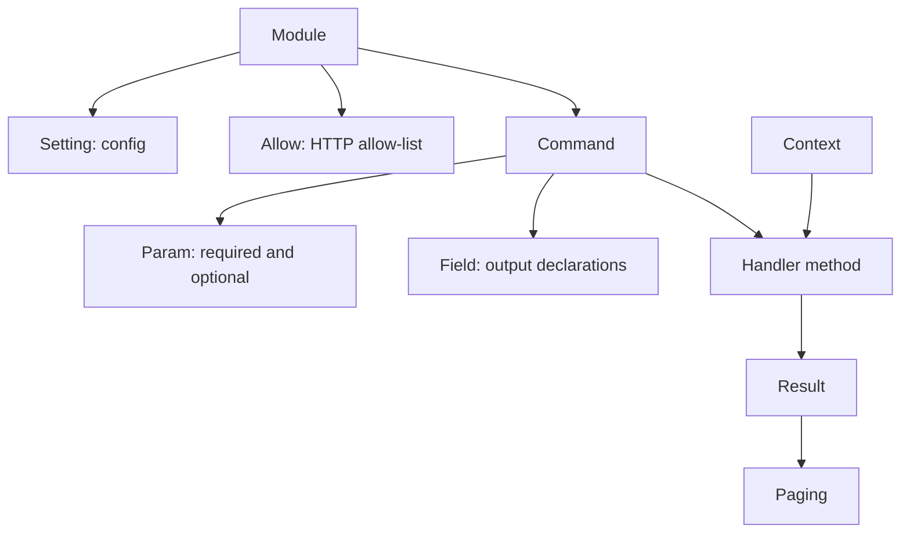
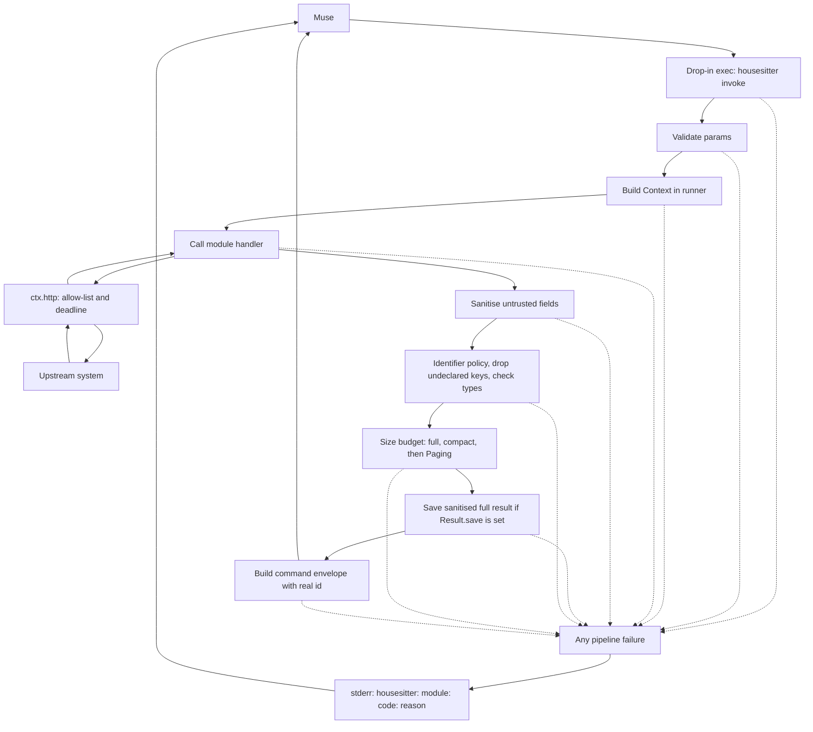

# Writing a module

Status: the public module API, registry, config loader, Context, runner,
store, drop-ins, CLI, and conformance suite are implemented. The
`housesitter conformance` CLI command is **Planned**.

A module is one source of data. It is a Python package that exposes one
`Module` subclass. It declares its config, secrets, HTTP allow-list,
commands, and output fields. The core is responsible for CLI, SDK
drop-ins, envelopes, size budget, identifier policy, storage, and errors.

## 1. Lifecycle of a new module

1. **Spec:** `docs/modules/<id>.md`. It covers purpose, the questions it
   helps Muse answer, upstream API and auth, the HTTP allow-list, commands,
   and the output schema (every field: name, type, unit, meaning, upstream
   source, identifier yes or no). It also states what the module cannot see.
   Jon reviews it before code is written.
2. **Fixtures:** invented upstream payloads in `tests/fixtures/<id>/`.
   Include typical, empty, and error fixtures, an edge-case fixture
   (missing fields, nulls, odd units), a hostile fixture (injection-style
   names, secret-bearing fields that must be dropped), and a large fixture
   (to exercise truncation).
3. **Code:** `src/housesitter/modules/<id>/`.
4. **Tests:** `tests/modules/<id>/`. These pin the normalised output
   field by field from the fixtures. The conformance suite picks up built-in
   modules automatically; supply its fixture manifest (§4).
5. **SKILL.md:** Muse-facing guidance, next to the code (§5).
6. **Review gates** ([REVIEW.md](REVIEW.md)), including the threat and
   privacy gate.

## 2. The public module API (`housesitter.sdk`)

The API is implemented in `sdk.py`. Declaration objects check their own
shape at construction. The runner validates incoming parameter values,
calls handlers, applies `Field` declarations, saves results when requested,
and builds the command envelope (ARCHITECTURE §3.4).

### Module declarations

Subclass `Module` and set these class attributes:

| Attribute | Purpose |
|-----------|---------|
| `id` | Unique module id, matching its package or entry-point name (§3). |
| `title` | Non-empty, human-readable title. |
| `version` | Module version, such as `0.1.0` (§3). |
| `config` | Mapping of setting names to `Setting` declarations; defaults to `{}`. |
| `http_allow` | Sequence of `Allow` entries; defaults to `()`. |
| `commands` | Non-empty sequence of `Command` declarations. |
| `skill_file` | Runtime guide filename; defaults to `"SKILL.md"`. |

Optionally override `check(self, ctx: Context) -> list[str]` for a read-only
connectivity check. The default returns `[]`. `housesitter doctor --check`
(or the `check` parameter of `housesitter.doctor`) calls it for enabled modules.
Its Context has a read-only store: `list` and `load` work without creating
directories or changing modes; `save` fails with `config_invalid`,
"doctor checks are read-only".

This illustrative module reads an invented sensor API. It shows the handler
contract; it is not an installed module:

```python
from housesitter.sdk import (
    Allow, Command, CommandError, Context, Field, Module, Param, Result, Setting,
)

class DemoSensor(Module):
    id = "demo_sensor"
    title = "Demo temperature sensor"
    version = "0.1.0"
    config = {"base_url": Setting("string", default="http://192.0.2.1")}
    http_allow = (Allow("GET", r"/api/temperature-example"),)
    commands = (
        Command(
            "snapshot", handler="snapshot",
            description="Read the current sensor temperature in degrees Celsius.",
            optional={"label": Param("string", "Note about this reading.", max_len=200)},
            fields=(Field("data.temperature_c", "number"),),
        ),
    )

    def snapshot(self, ctx: Context, params: dict) -> Result:
        with ctx.http(ctx.config["base_url"]) as session:
            response = session.get("/api/temperature-example")
        if response.status != 200:
            raise CommandError("upstream_unexpected", "Cannot read the sensor.")
        payload = response.json()
        value = payload.get("temperature_c")
        if isinstance(value, bool) or not isinstance(value, (int, float)):
            value = None
        return Result(data={"temperature_c": value}, label=params.get("label"))
```

### Settings and parameters

`Setting(type, required=False, default=None, enum=None, pattern=None,
minimum=None, maximum=None, max_len=None, properties=None)` describes one
config key. Types are `string`, `integer`, `number`, `boolean`, and
`object`; arrays are not supported. Objects require a non-empty
`properties` mapping of names to child `Setting` declarations. A required
setting cannot also have a non-`None` default. String patterns use a full
regular-expression match. Numeric bounds apply only to integers and
numbers; `max_len` is a positive string length limit. Booleans do not count
as numbers, and non-finite numbers are rejected.

The config loader applies these declarations now: missing or null values
use the default, or fail if required. Without a default they become `None`.
Present objects, or object defaults, resolve their child settings
recursively; unknown keys are errors in enabled sections. The core reserves
`enabled` and `retention`; modules must not declare them. A missing section
is disabled; a present section defaults to enabled. Disabled sections check
only `enabled` and `retention`, ignoring module-specific values and extra
keys.

`TLS_SETTING` is the shared object setting for encrypted HTTP (TLS). It has
`default={}` and properties `ca_file`, `server_hostname`,
`fingerprint_sha256` (optional strings), and `insecure` (boolean, default
`False`). Resolving its default fills the string properties with `None`.

`Param(type, description, enum=None, default=None, minimum=None,
maximum=None, max_len=None)` describes a command parameter. It accepts the
same scalar types as `Setting`, plus `object` and `array`, and requires a
non-blank description. Bounds and string limits follow the same rules as
settings; non-`None` defaults must satisfy their declared constraints.
The runner rejects unknown keys, missing or null required params, wrong
types, non-finite numbers, enum violations, numeric bounds, and string
length violations as `bad_params`. Booleans do not count as numbers.
Missing or null optionals use a non-null default when declared; otherwise
they are omitted from the handler's params.

The SDK drop-in format carries only `type` and `description`
(ARCHITECTURE §2.2). `param.drop_in_description()` appends constraints in
this order: enum (`"One of: ..."`), default, minimum, maximum, maximum
length. The drop-in generator and `describe` use that text; the runner
enforces the constraints on incoming values. Strings stay bare; other
values use compact JSON, for example `Default false.`.

### Commands and output

`Command(name, handler, description, required={}, optional={},
timeout_ms=30_000, fields=(), schema_version=1)` names a handler method and
its parameters. Command and parameter names match `[a-z][a-z0-9_]*`;
`handler` must be a Python identifier. Descriptions are non-blank strings
of at most 1024 characters. `required` and `optional` map names to `Param`
objects and cannot overlap. `timeout_ms` is an integer from 5000 through
600000. `fields` is a sequence of `Field` objects with unique paths.
`schema_version` is an integer of at least 1, intended for the envelope's
schema suffix.

`Command` rejects inconsistent field trees at construction. A segment
cannot be both a list (`x[]`) and an object (`x.child`). A plain `x`
declaration can accompany `x[]...` only when `x` is an `array` with no
children of its own. A declaration with non-list child fields must be an
`object`; this also applies to item declarations such as `x[]`. Every
`object` field must have at least one declared descendant; opaque object
leaves are rejected when the `Command` is defined.

`Field(path, type, nullable=True, identifier=False, untrusted=False,
max_len=64)` declares an output value. Paths start at `data.` or `source.`;
each dot-separated segment matches `[a-z_][a-z0-9_]*` and may end in `[]`
for a list, for example `data.aps[].signal_dbm` or `source.site`. Numeric
indices and bare `data` or `source` are invalid. Types are the six `Param`
types. `nullable`, `identifier`, and `untrusted` are booleans; `untrusted`
is allowed only for strings. `nullable` declares whether null is allowed;
`identifier` marks values such as device addresses, and `untrusted` marks
text supplied by upstream users or devices. `max_len` must be a positive
integer and declares the text length cap.
The runner sanitises declared untrusted strings, applies the identifier
policy, drops undeclared keys, and checks present values against their
declared types. Missing fields stay absent. Null is allowed only when the
value's own declaration has `nullable=True`; this includes declared list
and object containers with descendants. Undeclared (implied) containers
may be null. A mismatch becomes `upstream_unexpected` with the field path.

`x[]` means a list whose **items** are described by the rest of the path.
For `Field("data.values[]", "integer")`, each item must be an integer;
for `Field("data.aps[].name", "string")`, each AP must be an object and
each present name a string. Lists or tuples are accepted as containers.
`Field("data.values", "array")` instead declares the whole array. It may
accompany `data.values[]...` to govern the list value itself, including
`nullable` and `identifier`. Opaque leaves exist only as type `array`
(without declared descendants). Their items may contain only finite
numbers, booleans, null, and nested arrays of those. A string, object, or
non-finite number anywhere inside one causes `upstream_unexpected`.
Declare lists of strings item-wise, for example
`Field("data.tags[]", "string", untrusted=True)`, so each item is sanitised.
Every declared identifier value is omitted when `identifiers="none"`,
including nulls, before type checks. A terminal `x[]` identifier declaration
removes the whole list, including a null list value. Untrusted strings lose
control, formatting, and surrogate characters, have whitespace collapsed,
and are capped at the field's `max_len`, then stripped again so the cap
cannot leave an edge space.

`Result(data, source={}, compact=None, paging=None, warnings=(),
label=None, collected_at=None, save=None)` is what a handler returns.
`data` holds measurements and `source` their provenance; both must be
mappings. `compact` is an optional smaller data mapping. `warnings` is a
sequence of strings, `label` an optional string, and `collected_at` an
optional timezone-aware datetime (not necessarily UTC). `save`, when set,
is a kind matching `[a-z][a-z0-9_]{0,31}`, such as `"snapshot"`.
`Result` checks its own shape; fields belong to `Command`. The runner
applies identifier policy, drops undeclared keys, and checks types before
trying full output, then `compact`, then `paging` to fit the budget
(ARCHITECTURE §5). When `save` is set, fitting uses a stand-in saved id
of the same length and measured size as the real one. Only after all
projection and fitting checks pass does it save sanitised full data and
source from before projection, including identifiers and undeclared keys.
Projection or fitting failures leave no saved file. A fitting compact
result is not marked truncated. Warnings from the result and Context are
sanitised, capped at 200 characters, de-duplicated, and limited to 20; the last entry
reports any overflow count. Labels are sanitised and capped at 200.

`Paging(command, lists=(), params={}, start={})` describes how to fetch
remaining list items. `command` is a short command name such as `"get"`,
not a full dotted name. `lists` must be non-empty, unique short names,
in the intended truncation order. `params` carries paging parameters;
`section`, `offset`, and `remaining` are rejected keys at construction.
`id` is allowed. `start` maps listed names to non-negative integer offsets.
Lists are top-level data keys. The runner cuts them from the end in declared
order, emptying one before shrinking the next if necessary. `more.command` becomes
`housesitter.<module_id>.<command>` for module commands, or
`housesitter.<command>` for core commands. `more.params` copies `Paging.params`,
then sets `id` when saved, `section` to the first truncated list, and
`offset` to that section's start plus items kept. `more.remaining` maps
each cut list to the number of items cut; it is beside `params`, not inside
it. Before returning truncated output, the runner requires the target
command to exist in the module registry (or the core command table for
core commands) and declare `section` (string), `offset` (integer), and
`id` (string), in either `required` or `optional`. The replay must carry a
non-empty string `id`: the saved id, or `Paging.params["id"]` when a paging
command pages its own output with `save` unset. Otherwise it fails
with `upstream_unexpected`, "the module's paging cannot fetch the rest of
this result". Authors must ensure the handler can fetch the rest and
accepts all replay params; the runner does not check other parameters or
their constraints at this stage.

With paging lists present, if the smallest envelope still exceeds the
budget, the runner fails with
`upstream_unexpected`, "the result is too large even with paging: the part that cannot be paged is <N> bytes; the output limit is 90112 bytes".
The smallest envelope uses compact data if supplied, otherwise full data,
with all paging lists emptied, the saved id when applicable,
`truncated: true`, and the `more` object it would carry. `<N>` is its size
by `len(json.dumps(text)) - 2`; only the measured number is inserted,
never module or upstream text. Without paging, or with no declared paging
list present as a list, an oversized result fails with
`upstream_unexpected`, "the result is too large for the output limit".
If `start` has an entry for the section named by `more` and that section
keeps zero items while items remain, the runner fails with
`upstream_unexpected`, "one item in <section> is larger than the output limit".
`<section>` is the declared paging list name. This refuses a continuation
whose offset would not advance. A page without a start entry for that
section counts as a first page and may keep zero items. The runner
recognises a continuation only by its start entry, so a paging command
that continues a list must set `start` for it; without one, a repeat is
not detected. An empty list is never the truncated section.

A handler may raise `CommandError(code, reason)`. `code` must be in
`ERROR_CODES`; `reason` is author-written plain language, never upstream
text or secrets. The runner preserves its code and reason in the error
envelope; the CLI also prints the stable stderr error line.
The SDK also re-exports the core HTTP types `Allow`, `NotAllowed`,
`UpstreamError`, and `Response`, and the stable `ERROR_CODES` set.
`Allow(method, pattern, allow_query=False)` declares a permitted path;
the HTTP client uses a full regular-expression match on the normalised
path. `NotAllowed` reports off-list calls, `UpstreamError` carries a stable
code and optional status, and `Response` carries `status`, `headers`, and
`body`, with `json()` for parsing the body.

### Handler context

`sdk.Context` is the public interface; `core/context.py` supplies the
concrete implementation. `Context` gives a module these members:

| Member | Purpose |
|--------|---------|
| `ctx.module_id` | The module's id. |
| `ctx.config` | A deeply read-only copy of the supplied module config; validation belongs to the config loader. |
| `ctx.secret(name)` | Reads a named file from the secrets directory through the core secret reader, checking mode and ownership; failures become `CommandError("secret_unreadable", ...)`. |
| `ctx.http(base_url, *, tls=None, timeout_s=None)` | Returns an allow-listed `HttpSession`, bound to one scheme, host, and port; default request timeout is 15 seconds. |
| `ctx.store` | The runner injects a per-module store with `save`, `list`, and `load` (ARCHITECTURE §3.3). Without an attached store, using these methods raises `NotImplementedError`. Doctor checks get a read-only store. |
| `ctx.now()` | Timezone-aware current UTC time. Injectable in tests; an injected aware datetime is converted to UTC, and a naive one is rejected. |
| `ctx.log` | A logger that redacts values read through this Context's `secret`, including formatted messages, traceback text, and stack text. It does not discover unknown secrets. |
| `ctx.deadline` | Seconds left until the supplied monotonic deadline, floored at zero. |

HTTP sessions support `get`, `post`, `request`, `clear_auth`, `close`, and
use as a context manager (which closes the session). Each request passes
the remaining deadline to the core HTTP client; an expired deadline raises
`timeout` before sending. Responses with status 401 or 403 become
`UpstreamError` with code `upstream_auth`. `request` accepts `json` and
`headers`; a JSON body gets `Content-Type: application/json` unless supplied.
`clear_auth()` drops in-memory authentication state.

The SDK also defines the `Store` interface and its return types:
`StoredItem(id, kind, collected_at=None, label=None)` and
`StorePage(total, items=())`. `StorePage` checks a non-negative integer
count and a sequence of `StoredItem` objects. `StoredItem` checks a
store-shaped id, a valid matching kind prefix, optional collected-at text
in the exact shape `YYYY-MM-DDTHH:MM:SSZ`, and optional label text up to
200 characters. It checks the timestamp's shape, not calendar validity.
The concrete store creates directories and tightens wide data-root and
module-directory modes to 700 only on save, writes mode-600 JSON,
lists newest first with limit 1..100, and loads only store-shaped ids
(ARCHITECTURE §3.3).

The base URL must use `http` or `https` and contain a host, with an optional
port. A path other than an empty path or `/`, userinfo, a query, or a
fragment is refused. Timeout overrides must be positive finite numbers.
TLS accepts only the four `TLS_SETTING` keys. Active TLS options on `http`
are refused (null options and `insecure=False` are inert). Explicit
`insecure=True` adds a deduplicated warning to the concrete Context's
`warnings` list. The runner includes it in the command envelope.

### How the pieces fit

Declarations and the handler contract (these API types exist):



Command pipeline, adapted from the SDK diagram proposal:



The handler runs in a worker thread with a self-deadline (timeout minus
3 seconds). A module holding the GIL can delay the runner's timeout until
it releases the GIL (ARCHITECTURE §4). Field projection also checks declared
types. On failure the SDK discards stdout and gives Muse the last stderr line (ARCHITECTURE §2.2).

## 3. Rules a module must follow

The registry checks these rules when loading a module:

- The id matches `[a-z][a-z0-9_]*` and equals the built-in package name or
  third-party entry-point name. The id `housesitter` is reserved for core
  commands. Ids and full command names must be unique.
- The title is non-blank. The version matches
  `\d+\.\d+\.\d+([.-]?[0-9A-Za-z.]+)?`, for example `0.1.0`.
- `config` is a mapping of `Setting` objects, without reserved `enabled`
  or `retention` entries.
- `http_allow` is a sequence of `Allow` objects using only `GET`, `HEAD`,
  or `POST`. A `POST` pattern must be a literal path ending in `/login`
  or `/logout`, with preceding segments made of letters, digits, `_`, or
  `-`. No regex alternatives or wildcards for POST. This is a guard rail,
  not a sandbox or proof that an endpoint is read-only.
- There is at least one `Command`, names do not repeat, and each named
  handler exists and is callable. The full name
  `housesitter.<module_id>.<command>` is at most 64 characters.

Module authors must also follow these rules:

- Import only the module's own package, `housesitter.sdk`, and the stdlib
  (AGENTS rule 9). Do no network I/O except through `ctx.http`.
  The import-scan lint (`tests/conformance/test_imports.py`) scans each
  tested module's Python files. It allows its own package, `housesitter.sdk`
  (including `from housesitter import sdk`), and stdlib imports except
  `socket`, `ssl`, `urllib`, the whole `http` package (`import http`
  alone exposes `http.client` once the core has loaded it), `subprocess`,
  `ctypes`, `importlib`, `builtins`, `pty`, `multiprocessing`, and
  `concurrent.futures.process`; it rejects `requests`, other non-stdlib
  imports, and other Housesitter imports. It also flags the names
  `__import__` and `__builtins__`, and these attributes on a simple name:
  `anything.__import__`, `sys.modules`, `os.system`, `os.popen`, any `os`
  attribute starting with `spawn`, `exec`, `fork`, or `posix_spawn`,
  `asyncio.create_subprocess_exec`, `asyncio.create_subprocess_shell`, and
  `io.open`. Modules must not bind or call the name `open`: the lint
  conservatively flags bare `open(...)` calls even when `open` is a local
  variable or parameter. These attribute checks use the literal names,
  without resolving aliases.
  Relative imports are skipped. It also scans `core/*.py`, `sdk.py`,
  `__init__.py`, and `__main__.py` for absolute imports of
  `housesitter.modules.<name>` and `from housesitter.modules import ...`;
  importing the `housesitter.modules` package itself is allowed.
  The lint reads source only: indirect access through `getattr` chains,
  `pkgutil.importlib`, or objects reached through other modules can get
  past it, as can I/O reached another way. It is a guard rail that review
  backs up, not a sandbox.
- Do no file I/O except through `ctx.store` and `ctx.secret`. Never write
  outside the data dir. Log only through `ctx.log`, as part of the rule
  that module I/O goes through Context.
- Normalise by **allow-listing** upstream fields into documented output
  fields. Never pass through an upstream object.
- Put units in field names. Use `null` for unknown, never `0` or `""` as a
  stand-in.
- Mark identifier fields (`Field(identifier=True)`) and untrusted text
  fields (`Field(untrusted=True)`). The runner applies both declarations.
- No scores, rankings, verdicts, or advice in `data` (AGENTS rule 2).
  Upstream-provided scores, such as UniFi's `satisfaction`, may be passed
  through, labelled as the vendor's metric.
- Command descriptions are static strings, written for Muse: what the
  command reads, what it saves, and roughly how long it takes.
- Warnings are author-written plain-language facts. They must never
  contain identifiers (MACs or IPs), upstream text, or secrets: the runner
  sanitises and caps warnings but cannot apply the identifier policy
  inside free text. Conformance checks fixture output for these leaks (§4).
- Never put identifiers, upstream text, or secrets in `Paging.params`: they
  are returned in `more.params` verbatim, outside the identifier policy.
  Page through the saved id instead. Conformance checks fixture output
  for these leaks (§4).

## 4. Conformance suite

The suite lives in `tests/conformance/`. It runs against every built-in
module from `load_registry(include_entry_points=False)` plus
`conformance_demo`, a test-only module under `tests/`. The demo is
registered only through `Registry.from_classes` and is never installed.
Third-party entry-point modules are excluded.

Each module supplies `tests/fixtures/<id>/conformance.json`, with:

- `config`: a module config object; `{port}` in its string values is
  replaced with the fixture server's port.
- `secrets`: a mapping of file names to invented string values.
- `spec`: a non-empty path relative to the repo root.
- `cases`: a non-empty list with unique, non-empty `name` values. Each
  case has a `fixture` kind, short `command`, optional `params` object
  (default `{}`), non-empty `routes`, and `expect`: `"ok"`, `"truncated"`,
  or `{"error": "<stable error code>"}`. Each route has `method`, an
  absolute `path`, and integer `status` (100..599), with optional string
  `body` or fixture-relative `body_file` (not both), and string-valued
  `headers`. Unknown manifest, case, and route keys are rejected.

Every module must cover `typical`, `empty`, `error`, `large`, and `hostile`
fixture kinds. See `tests/fixtures/conformance_demo/conformance.json` for
an example. Only `empty` has a semantic label check: a case expecting
`ok` must return empty top-level data lists. Other labels are the author's
declaration; the separate checks below still apply.
Each case gets its own temporary HOME, config, and secrets directory; a
snapshot and its paging follow-ups share one. `os.environ` is restored
after each synchronous run; threads that outlive the command are outside
harness output capture, save recording, and environment restoration
guarantees.
Output when a module is first imported is also outside harness capture.
The CLI guard discards import-time and late-thread output in production
except for `serve` (ARCHITECTURE §4); it does not extend save or environment guarantees.
Inline route bodies are parsed as JSON for planted-secret
and string-leaf harvesting, or treated literally if parsing fails; route
header values are harvested too.
The harness passes `client_factory` to `run_command`, returning a real
`http.Client` aimed at a loopback plain HTTP scripted server. The real
allow-list, framing, and redirect handling run. TLS handshakes, CA loading,
certificate checks, and real destination identity are not exercised;
the requested scheme, host, and port are checked against config instead.

Per-run checks cover the first run and every paging follow-up: envelope,
HTTP requests and client binding, secrets, declared envelope and raw
fields, sanitisation, and warnings/params (where applicable to success).
The field and sanitisation walkers treat tuples as lists.

A module is not mergeable until it passes:

- The id and command names are valid. The full names are at most 64
  characters. Every full name starts with `housesitter.`, so the SDK's
  reserved prefixes (`system.`, `file.`, `device.`, `link.`) cannot match.
- Generated drop-ins pass independently checked SDK rules
  (ARCHITECTURE §2.2): names, keys, descriptions, exec, parameters,
  timeouts, and the 64 KiB per-file cap.
- Every fixture case returns the expected success, truncation, or error
  envelope, with the checked schema and metadata or stable error line.
- Every case and follow-up page fits 88 KiB by `len(json.dumps(text)) - 2`.
  The harness captures `sys.stdout`/`sys.stderr` and file descriptors 1
  and 2; any captured output fails. This catches `print()`,
  `os.write(1/2, …)`, and writes through `sys.__stdout__`/`sys.__stderr__` or stream
  references saved earlier when they reach those descriptors during the
  run. Buffered output that reaches them only after return is outside
  harness capture, as are import-time output and threads that outlive the
  command. The production CLI guard (except for `serve`) discards these too
  (ARCHITECTURE §4).
  The harness calls `run_command` directly without that guard, so it still
  detects stray output rather than hiding it.
  A module declaring a list (`x[]`) or an opaque `array` field in `data`
  needs at least one large and one hostile case that truncates; a hostile
  case for a command that never pages may expect `ok`.
  The harness follows `more` for at most 50 follow-ups. Checks require
  every follow-up to be `ok` and replay the previous `more.params` exactly,
  with offset equal to start plus items kept and the section's remaining
  count equal to the true count left. The last page must have `more: null`;
  reaching the cap with more pages left fails. Checks verify the registered
  target, store-shaped paging id, section, and positive remaining counts,
  and require the returned item count to match the saved section from
  its start offset. Each returned item is compared with the saved item at
  the same position, on the keys the returned item has. This checks order,
  duplicate counts, and retained values, while allowing compact forms and
  `identifiers: none` to omit keys, including ids. Differences only in
  omitted keys cannot be detected.
- Recorded HTTP requests are re-checked against `http_allow`, and client
  bindings against config. Probes on recorded GET paths check that
  off-list paths and write methods, `..`, `%2e%2e`, and an unopted
  `?query` raise `NotAllowed` without opening a socket. A 302 raises
  `upstream_unexpected` and is not followed.
- Strings declared untrusted are checked for sanitisation and caps in
  every successful case and follow-up page:
  no control, formatting, or surrogate characters, repeated whitespace,
  or edge spaces remain. Hostile cases must also hold raw input that
  sanitising changes. Whether fields are correctly declared untrusted is
  a gate 3 review responsibility, not proven by the suite.
- Planted values containing `PLANTED-SECRET` are scanned in the serialised
  envelope, captured stdout and stderr, saved files and payloads recorded
  at write time (before retention can hide them), logs, and the error line.
  Both Python-stream and file-descriptor captures are scanned. Log capture
  covers records reaching the `housesitter` logger at all standard levels,
  including formatted messages, exception tracebacks, and stack text.
  With default settings, all `ctx.log` records reach it: Context creates a
  `housesitter.<id>` logger parented to `housesitter`. Other loggers,
  loggers with `propagate=False` (including a modified `ctx.log`), and
  handlers writing elsewhere are outside this log capture. Modules must
  log only through `ctx.log` (§3). Scanning matches exact substrings:
  encoded, reversed, case-changed, or split secrets are not detected.
- Every field in envelope `data` and `source` is declared. The handler's
  raw `Result.data`, `source`, and `compact` must also contain no
  undeclared keys, even if the runner would drop them.
- Spec tables and declared fields match in both directions, across the
  module's commands. The spec format that makes this possible:
  - One Markdown table per object, headed by a line containing only the
    object's path in backticks (e.g. `` `data.aps[].radios[]` ``).
  - One field per row, with the field name in the first column in
    backticks.
  - The tables also cover `summary` and `source`.
  Tables inside triple-backtick code fences are ignored; duplicate object
  tables are rejected.
- Warnings and string values in `more.params` (except `id`, `section`,
  and `offset`) contain no recognised MAC/IP addresses, planted secrets,
  fixture upstream strings of six or more characters (a single lowercase
  word is skipped, since author text can share it), or raw declared
  identifier/untrusted values (matched as whole tokens). `id` must be a
  store id. Non-string params are counted but not recursively inspected;
  this check does not prove all free text safe.
- `SKILL.md` is readable; its first line opens `---` front matter, which
  must have a closing `---` fence.
  The checker accepts a small scalar subset for `name` and `description`,
  not full YAML. Both keys are required; unknown and duplicate keys are
  rejected. Blank lines and comment lines are skipped; other lines must
  be unindented `key: value` entries, except block content:
  - Single- or double-quoted values must end with the opening quote and
    have non-empty content after trimming; plain-scalar restrictions do
    not apply inside quotes. YAML escapes are not decoded.
  - Plain values must be non-empty after trimming and removing comments
    (`#` at the start or after whitespace). They cannot contain `: `, be
    `null`, `~`, `true`, `false`, `yes`, or `no` (any case), or start with
    any of `[`, `{`, `&`, `*`, `!`, `|`, `>`, `#`.
  - Block markers `>`, `>-`, `>+`, `|`, `|-`, and `|+` need non-empty
    content in the following indented lines.
  The body mentions every full command name. The text is scanned for
  `PLANTED-SECRET` and exact planted values.
- Every command in the real built-in module registry has an evidence
  scenario. The demo is excluded because evidence runs the installed CLI
  (REVIEW.md).

Non-vacuity guards require a non-empty module list including the demo,
all five fixture kinds, planted secrets, genuinely dirty raw hostile
text, scanned source files, and positive examined counts where asserted
by the tests.
Warnings/params counts are aggregated per module; a module with nothing
to examine must show that no successful case returned warnings or
`more`. Evidence may examine zero
module commands while no built-in data module is installed.

`test_mutations.py` deliberately breaks modules, core behaviour, and
copies of specs, skills, scenarios, and source files. Each fault must fail
its check while an unmodified control passes. They demonstrate detection
of the specific faults tested, not every way to break a rule.

## 5. SKILL.md for a module

This is the runtime guide for Muse, returned as `skill` for each module by
`housesitter.describe`. It uses the SDK community-skill shape:

```markdown
---
name: housesitter-unifi-wifi
description: >-
  Read WiFi radio metrics (APs, channels, signal, rates, retries) from the home's
  UniFi controller through Housesitter on this Pi. Read-only.
---
# When to use it
# Commands (one line each, with an example call)
# Reading the fields (units, normal ranges, plain-language meaning)
# How much to trust a number (one moment in time, jitter, vendor scores)
# Comparing snapshots (labels, before/after, matching devices by id; private MACs can change)
# Untrusted data and privacy
# Limits: what this module cannot see; it never changes anything
```

## 6. Third-party modules

A separate package can provide modules through the entry point
`housesitter.modules`, for example in its `pyproject.toml`:

```toml
[project.entry-points."housesitter.modules"]
my_sensor = "my_package.module:MySensor"
```

The registry loads the entry point as a `Module` subclass whose id must
equal the entry-point name, and records it as third-party. A load failure
stops discovery rather than silently skipping the module.

Third-party handlers get the same `Context` and runner pipeline as built-ins.
`describe` reports `third_party: true` for them. The repo's conformance
suite excludes third-party entry points. **Planned:** conformance for
third-party modules through `housesitter conformance my_sensor`.
