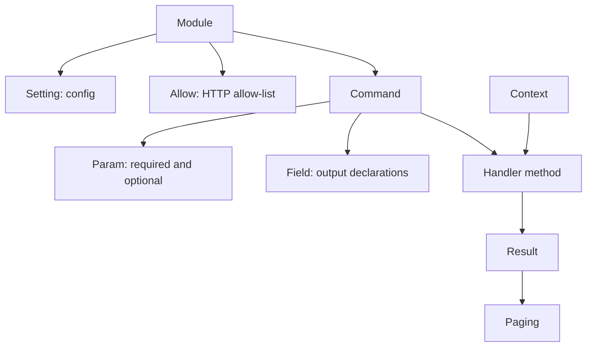
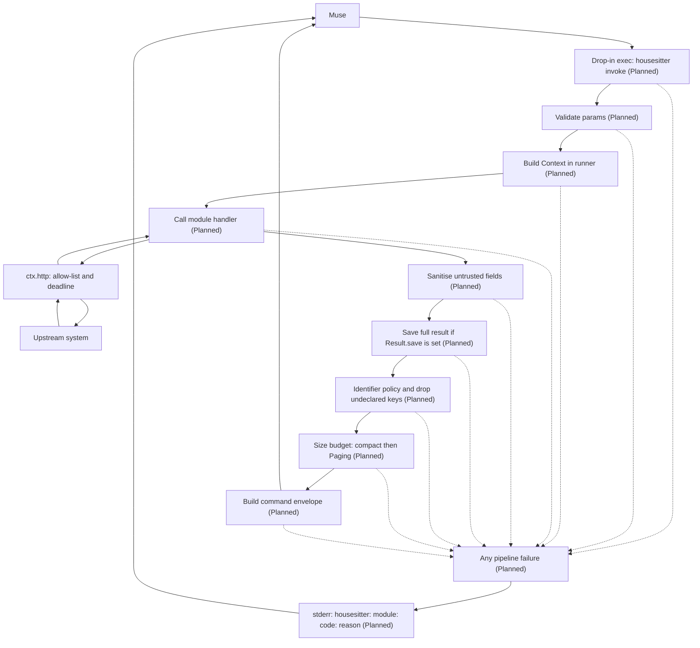

# Writing a module

Status: the public module API, registry, config loader, and concrete Context
exist (12a). The pieces that run a command are **Planned** (12b); the
conformance suite is **Planned** (12c).

A module is one source of data. It is a Python package that exposes one
`Module` subclass. It declares its config, secrets, HTTP allow-list,
commands, and output fields. The core is responsible for CLI, SDK
drop-ins, envelopes, size budget, identifier policy, storage, and errors;
command execution and storage are still **Planned**.

## 1. Lifecycle of a new module

1. **Spec:** `docs/modules/<id>.md`. It covers purpose, the questions it
   helps Muse answer, upstream API and auth, the HTTP allow-list, commands,
   and the output schema (every field: name, type, unit, meaning, upstream
   source, identifier yes or no). It also states what the module cannot see.
   Jon reviews it before code is written.
2. **Fixtures:** invented upstream payloads in `tests/fixtures/<id>/`.
   Include an edge-case fixture (missing fields, nulls, odd units), a
   hostile fixture (injection-style names, secret-bearing fields that must
   be dropped), and a large fixture (to exercise truncation).
3. **Code:** `src/housesitter/modules/<id>/`.
4. **Tests:** `tests/modules/<id>/`. These pin the normalised output
   field by field from the fixtures. **Planned:** the conformance suite will
   pick the module up automatically.
5. **SKILL.md:** Muse-facing guidance, next to the code (§5).
6. **Review gates** ([REVIEW.md](REVIEW.md)), including the threat and
   privacy gate.

## 2. The public module API (`housesitter.sdk`)

The API is implemented in `sdk.py`. Declaration objects check their own
shape at construction. **Planned (12b):** the runner that validates incoming
parameter values, calls handlers, applies `Field` declarations, saves
results, and builds the command envelope. Nothing applies `Field`
declarations at runtime yet.

### Module declarations

Subclass `Module` and set these class attributes:

| Attribute | Purpose |
|-----------|---------|
| `id` | Unique module id, matching its package or entry-point name (§3). |
| `title` | Non-empty, human-readable title. |
| `version` | Module version, such as `0.1.0` (§3). |
| `config` | Mapping of setting names to `Setting` declarations; defaults to `{}`. |
| `http_allow` | Sequence of `Allow` entries; defaults to `()`. |
| `commands` | Non-empty sequence of `Command` declarations. |
| `skill_file` | Runtime guide filename; defaults to `"SKILL.md"`. |

Optionally override `check(self, ctx: Context) -> list[str]` for a read-only
connectivity check. The default returns `[]`; calling it through `doctor`
is **Planned**.

This illustrative module reads an invented sensor API. It shows the handler
contract, not a command that the CLI can run yet:

```python
from housesitter.sdk import (
    Allow, Command, CommandError, Context, Field, Module, Param, Result, Setting,
)

class DemoSensor(Module):
    id = "demo_sensor"
    title = "Demo temperature sensor"
    version = "0.1.0"
    config = {"base_url": Setting("string", default="http://192.0.2.1")}
    http_allow = (Allow("GET", r"/api/temperature-example"),)
    commands = (
        Command(
            "snapshot", handler="snapshot",
            description="Read the current sensor temperature in degrees Celsius.",
            optional={"label": Param("string", "Note about this reading.", max_len=200)},
            fields=(Field("data.temperature_c", "number"),),
        ),
    )

    def snapshot(self, ctx: Context, params: dict) -> Result:
        with ctx.http(ctx.config["base_url"]) as session:
            response = session.get("/api/temperature-example")
        if response.status != 200:
            raise CommandError("upstream_unexpected", "Cannot read the sensor.")
        payload = response.json()
        value = payload.get("temperature_c")
        if isinstance(value, bool) or not isinstance(value, (int, float)):
            value = None
        return Result(data={"temperature_c": value}, label=params.get("label"))
```

### Settings and parameters

`Setting(type, required=False, default=None, enum=None, pattern=None,
minimum=None, maximum=None, max_len=None, properties=None)` describes one
config key. Types are `string`, `integer`, `number`, `boolean`, and
`object`; arrays are not supported. Objects require a non-empty
`properties` mapping of names to child `Setting` declarations. A required
setting cannot also have a non-`None` default. String patterns use a full
regular-expression match. Numeric bounds apply only to integers and
numbers; `max_len` is a positive string length limit. Booleans do not count
as numbers, and non-finite numbers are rejected.

The config loader applies these declarations now: missing or null values
use the default, or fail if required. Without a default they become `None`.
Present objects, or object defaults, resolve their child settings
recursively; unknown keys are errors in enabled sections. The core reserves
`enabled` and `retention`; modules must not declare them. A missing section
is disabled; a present section defaults to enabled. Disabled sections check
only `enabled` and `retention`, ignoring module-specific values and extra
keys.

`TLS_SETTING` is the shared object setting for encrypted HTTP (TLS). It has
`default={}` and properties `ca_file`, `server_hostname`,
`fingerprint_sha256` (optional strings), and `insecure` (boolean, default
`False`). Resolving its default fills the string properties with `None`.

`Param(type, description, enum=None, default=None, minimum=None,
maximum=None, max_len=None)` describes a command parameter. It accepts the
same scalar types as `Setting`, plus `object` and `array`, and requires a
non-blank description. Bounds and string limits follow the same rules as
settings; non-`None` defaults must satisfy their declared constraints.
Only the **definitions** are checked now; incoming parameter values are
not validated yet.

The SDK drop-in format carries only `type` and `description`
(ARCHITECTURE §2.2). `param.drop_in_description()` appends constraints in
this order: enum (`"One of: ..."`), default, minimum, maximum, maximum
length. **Planned:** the drop-in generator will use that text, and the
runner will enforce the constraints on incoming values.

### Commands and output

`Command(name, handler, description, required={}, optional={},
timeout_ms=30_000, fields=(), schema_version=1)` names a handler method and
its parameters. Command and parameter names match `[a-z][a-z0-9_]*`;
`handler` must be a Python identifier. Descriptions are non-blank strings
of at most 1024 characters. `required` and `optional` map names to `Param`
objects and cannot overlap. `timeout_ms` is an integer from 5000 through
600000. `fields` is a sequence of `Field` objects with unique paths.
`schema_version` is an integer of at least 1, intended for the envelope's
schema suffix.

`Field(path, type, nullable=True, identifier=False, untrusted=False,
max_len=64)` declares an output value. Paths start at `data.` or `source.`;
each dot-separated segment matches `[a-z_][a-z0-9_]*` and may end in `[]`
for a list, for example `data.aps[].signal_dbm` or `source.site`. Numeric
indices and bare `data` or `source` are invalid. Types are the six `Param`
types. `nullable`, `identifier`, and `untrusted` are booleans; `untrusted`
is allowed only for strings. `nullable` declares whether null is allowed;
`identifier` marks values such as device addresses, and `untrusted` marks
text supplied by upstream users or devices. `max_len` must be a positive
integer and declares the text length cap.
**Planned:** the runner will use these declarations to sanitise untrusted
text, apply the identifier policy, and drop undeclared keys.

`Result(data, source={}, compact=None, paging=None, warnings=(),
label=None, collected_at=None, save=None)` is what a handler returns.
`data` holds measurements and `source` their provenance; both must be
mappings. `compact` is an optional smaller data mapping. `warnings` is a
sequence of strings, `label` an optional string, and `collected_at` an
optional timezone-aware datetime (not necessarily UTC). `save`, when set,
is a kind matching `[a-z][a-z0-9_]{0,31}`, such as `"snapshot"`.
**Planned:** saving when `save` is set, and using `compact` and `paging`
to fit the size budget. `Result` currently checks only its own shape;
fields belong to `Command`, not `Result`.

`Paging(command, lists=(), params={}, start={})` describes how to fetch
remaining list items. `command` is a short command name such as `"get"`,
not a full dotted name. `lists` must be non-empty, unique short names,
in the intended truncation order. `params` carries paging parameters;
`start` maps listed names to non-negative integer offsets. Applying this
metadata is **Planned**.

A handler may raise `CommandError(code, reason)`. `code` must be in
`ERROR_CODES`; `reason` is author-written plain language, never upstream
text or secrets. Translating it into command output is **Planned**.
The SDK also re-exports the core HTTP types `Allow`, `NotAllowed`,
`UpstreamError`, and `Response`, and the stable `ERROR_CODES` set.
`Allow(method, pattern, allow_query=False)` declares a permitted path;
the HTTP client uses a full regular-expression match on the normalised
path. `NotAllowed` reports off-list calls, `UpstreamError` carries a stable
code and optional status, and `Response` carries `status`, `headers`, and
`body`, with `json()` for parsing the body.

### Handler context

`sdk.Context` is the public interface; `core/context.py` supplies the
concrete implementation. `Context` gives a module these members:

| Member | Purpose |
|--------|---------|
| `ctx.module_id` | The module's id. |
| `ctx.config` | A deeply read-only copy of the supplied module config; validation belongs to the config loader. |
| `ctx.secret(name)` | Reads a named file from the secrets directory through the core secret reader, checking mode and ownership; failures become `CommandError("secret_unreadable", ...)`. |
| `ctx.http(base_url, *, tls=None, timeout_s=None)` | Returns an allow-listed `HttpSession`, bound to one scheme, host, and port; default request timeout is 15 seconds. |
| `ctx.store` | **Planned (12b):** `save`, `list`, `load`. Without an injected store, all three raise `NotImplementedError`. |
| `ctx.now()` | Timezone-aware current UTC time. Injectable in tests; an injected aware datetime is converted to UTC, and a naive one is rejected. |
| `ctx.log` | A logger that redacts values read through this Context's `secret`, including formatted messages, traceback text, and stack text. It does not discover unknown secrets. |
| `ctx.deadline` | Seconds left until the supplied monotonic deadline, floored at zero. |

HTTP sessions support `get`, `post`, `request`, `clear_auth`, `close`, and
use as a context manager (which closes the session). Each request passes
the remaining deadline to the core HTTP client; an expired deadline raises
`timeout` before sending. Responses with status 401 or 403 become
`UpstreamError` with code `upstream_auth`. `request` accepts `json` and
`headers`; a JSON body gets `Content-Type: application/json` unless supplied.
`clear_auth()` drops in-memory authentication state.

The SDK also defines the `Store` interface and its return types:
`StoredItem(id, kind, collected_at=None, label=None)` and
`StorePage(total, items=())`. `StorePage` checks a non-negative integer
count and a sequence of `StoredItem` objects. The concrete store is
**Planned**.

The base URL must use `http` or `https` and contain a host, with an optional
port. A path other than an empty path or `/`, userinfo, a query, or a
fragment is refused. Timeout overrides must be positive finite numbers.
TLS accepts only the four `TLS_SETTING` keys. Active TLS options on `http`
are refused (null options and `insecure=False` are inert). Explicit
`insecure=True` adds a deduplicated warning to the concrete Context's
`warnings` list; including it in a command envelope is **Planned**.

### How the pieces fit

Declarations and the handler contract (these API types exist):



Command pipeline, adapted from the SDK diagram proposal:



**Planned** nodes are the 12b integration, even where they will call
existing Context, HTTP, or envelope helpers. On failure the SDK discards
stdout and gives Muse the last stderr line (ARCHITECTURE §2.2).

## 3. Rules a module must follow

The registry checks these rules when loading a module:

- The id matches `[a-z][a-z0-9_]*` and equals the built-in package name or
  third-party entry-point name. Ids and full command names must be unique.
- The title is non-blank. The version matches
  `\d+\.\d+\.\d+([.-]?[0-9A-Za-z.]+)?`, for example `0.1.0`.
- `config` is a mapping of `Setting` objects, without reserved `enabled`
  or `retention` entries.
- `http_allow` is a sequence of `Allow` objects using only `GET`, `HEAD`,
  or `POST`. A `POST` pattern must be a literal path ending in `/login`
  or `/logout`, with preceding segments made of letters, digits, `_`, or
  `-`. No regex alternatives or wildcards for POST. This is a guard rail,
  not a sandbox or proof that an endpoint is read-only.
- There is at least one `Command`, names do not repeat, and each named
  handler exists and is callable. The full name
  `housesitter.<module_id>.<command>` is at most 64 characters.

Module authors must also follow these rules:

- Import only the module's own package, `housesitter.sdk`, and the stdlib
  (AGENTS rule 9). Do no network I/O except through `ctx.http`.
  **Planned (12c):** an import-scan lint will flag `socket`, `ssl`, `urllib`,
  `http.client`, `requests`, `subprocess`, and `ctypes` in `modules/`. It
  is a guard rail that review backs up, not a sandbox.
- Do no file I/O except through `ctx.store` and `ctx.secret`. Never write
  outside the data dir.
- Normalise by **allow-listing** upstream fields into documented output
  fields. Never pass through an upstream object.
- Put units in field names. Use `null` for unknown, never `0` or `""` as a
  stand-in.
- Mark identifier fields (`Field(identifier=True)`) and untrusted text
  fields (`Field(untrusted=True)`). **Planned:** the runner will handle both.
- No scores, rankings, verdicts, or advice in `data` (AGENTS rule 2).
  Upstream-provided scores, such as UniFi's `satisfaction`, may be passed
  through, labelled as the vendor's metric.
- Command descriptions are static strings, written for Muse: what the
  command reads, what it saves, and roughly how long it takes.

## 4. Conformance suite

**Planned (12c):** the suite will live in `tests/conformance/` and run
against every registered module with its fixtures. A module is not mergeable until it passes:

- The id and command names are valid. The full names are at most 64
  characters and don't use reserved prefixes.
- Generated drop-ins pass the SDK rules (ARCHITECTURE §2.2).
- Every command, run against the fixture transport, returns a valid
  envelope. The large and hostile fixtures stay within the 88 KiB budget, as measured by the SDK's formula, with correct `more`
  paging.
- Every HTTP call is in `http_allow`. A deliberate off-list call raises
  `NotAllowed`.
- The hostile fixture produces sanitised, capped names, and none of its
  planted secret values appear in output, saved files, or logs.
- Every field in `data` is declared, and every declared field is in the
  module spec. The test parses the spec's field tables. The spec format
  that makes this possible:
  - One Markdown table per object, headed by a line containing only the
    object's path in backticks (e.g. `` `data.aps[].radios[]` ``).
  - One field per row, with the field name in the first column in
    backticks.
  - The tables also cover `summary` and `source`.
- `SKILL.md` exists, has YAML `name` and `description`, and mentions every
  command.

## 5. SKILL.md for a module

This is the runtime guide for Muse. Returning it through
`housesitter.describe` is **Planned**. It uses the SDK community-skill shape:

```markdown
---
name: housesitter-unifi-wifi
description: >-
  Read WiFi radio metrics (APs, channels, signal, rates, retries) from the home's
  UniFi controller through Housesitter on this Pi. Read-only.
---
# When to use it
# Commands (one line each, with an example call)
# Reading the fields (units, normal ranges, plain-language meaning)
# How much to trust a number (one moment in time, jitter, vendor scores)
# Comparing snapshots (labels, before/after, matching devices by id; private MACs can change)
# Untrusted data and privacy
# Limits: what this module cannot see; it never changes anything
```

## 6. Third-party modules

A separate package can provide modules through the entry point
`housesitter.modules`, for example in its `pyproject.toml`:

```toml
[project.entry-points."housesitter.modules"]
my_sensor = "my_package.module:MySensor"
```

The registry loads the entry point as a `Module` subclass whose id must
equal the entry-point name, and records it as third-party. A load failure
stops discovery rather than silently skipping the module.

**Planned:** third-party handlers will get the same `Context` and conformance
suite (`housesitter conformance my_sensor`) as built-ins, and `describe`
will label them as third-party.
